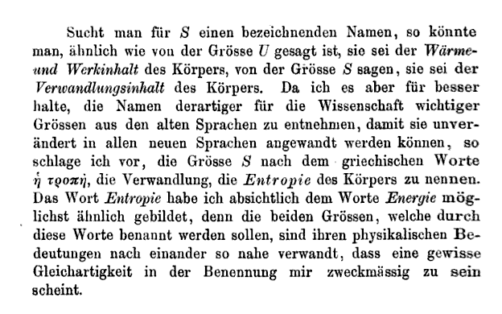

# Image to Notes Extractor

This project is a lightweight starter for using Google Gemini's Gemma 4 model in Python to build an image-to-notes workflow. It includes a shared `gemma_client.py` helper, a simple terminal chat runner, and a sample image for experimentation.

## Model

- Model: `gemma-4-26b-a4b-it`
- API provider: Google GenAI / Gemini API
- Environment variable: `GEMINI_API_KEY`

## Features

- Centralized Gemini/Gemma client helper
- API key validation and safe retry handling
- Optional caching for repeated prompts
- Sample image included for testing image-based workflows
- Minimal terminal interface for quick experimentation

## Project structure

- `gemma_client.py` — shared helper for calling the Gemma model
- `image_to_notes.py` — terminal interface for interacting with the model
- `requirements.txt` — Python dependencies
- `Text_entropy.png` — sample input image
- `.env` — local environment variables (not committed)

## Setup

1. Create and activate a virtual environment:

```powershell
python -m venv .venv
.\.venv\Scripts\Activate.ps1
```

2. Install dependencies:

```powershell
pip install -r requirements.txt
```

3. Create a local `.env` file with your Gemini API key:

```env
GEMINI_API_KEY=your_api_key_here
GEMMA_MODEL=gemma-4-26b-a4b-it
```

Important:
- Keep `.env` local and do not commit it to Git.
- If you do not have a key, create one in Google AI Studio and paste it into `.env`.

## Run

From the project root:

```powershell
python image_to_notes.py
```

You can also try the sample image or a custom image path in a workflow that uses the model helper:

```powershell
python image_to_notes.py .\Text_entropy.png
```

## Screenshot



## Notes

- The project uses the `google-genai` package from `requirements.txt`.
- The client helper reads `.env` automatically when `python-dotenv` is available.
- The model and behavior are easy to tune in `gemma_client.py` via environment variables such as `GEMMA_MODEL`, `GEMMA_CACHE`, and `MIN_SECONDS_BETWEEN_CALLS`.
